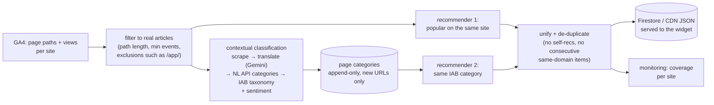

# Content recommendations and contextual classification for publishers

**Domain:** publisher engagement and contextual advertising · **Stack:** Airflow, GA4 Data API, Google Cloud Natural
Language API, Gemini, BigQuery, Firestore / CDN JSON, Cloud Functions, web scraping

## Problem

The network offered publishers an "articles you may like" widget and contextual (cookieless) ad targeting. Both need
to know, for every article on every site, **what it is about** and **what's popular**, refreshed daily and served
fast to the browser.

## Pipeline

- **Article detection without a CMS.** Only GA4 page paths are available, so heuristics separate articles from
  section pages and apps: minimum path length, minimum event count, and an exclusion list.
- **Classification.** Article text is scraped and translated to English (moved from a free translation endpoint that
  rate-limited to Gemini Flash-Lite), then classified with the Natural Language API. Categories are mapped to the IAB
  content taxonomy that ad buyers target, and sentiment is attached so negative news can be excluded from brand-safe
  campaigns.
- **Incremental.** Only URLs not classified before are processed (append-only), which keeps API cost proportional to
  new content, not to traffic.
- **Recommendations.** Popular-on-site and same-category candidates are merged, de-duplicated and shuffled, so one
  domain never dominates consecutive slots. The pool was enlarged (to 20+ candidates) so enough valid items survive
  filtering.

## My part

I maintained and extended both pipelines: rebuilt the recommendation flow on the newer GA4-based input with the
article filters, retired a deprecated recommender, made classification incremental, made it survive
translation-API rate limits, and replaced the translation step with Gemini. I also moved it to the new Composer
environment with Terraform-defined resources.

[TODO: sites covered, articles classified/day, widget CTR if known]
