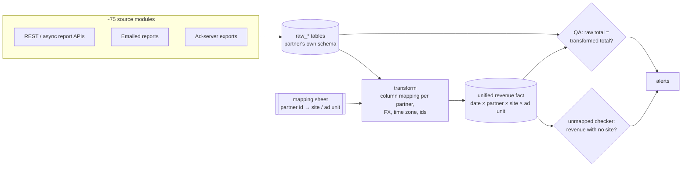

# Unifying revenue from 70+ demand partners

**Domain:** programmatic advertising · **Stack:** Airflow (Cloud Composer), Python, pandas, BigQuery, Google Sheets as a config UI, Gmail API, partner REST/report APIs

## Problem

A publisher network earns money through dozens of demand partners: SSPs, ad exchanges, video and native platforms,
header-bidding wrappers and the ad server itself. Each partner delivers revenue differently:

- REST APIs (some synchronous, some "request a report → poll → download")
- scheduled CSV/XLSX reports sent **by email**
- exports from the ad server in formats that change without notice

They also disagree on everything else: revenue column names (`revenue`, `net_revenue_sum`, `media_cost`, …),
currencies, time zones, and how they identify a site or ad unit. Finance, publisher payouts and every dashboard need
**one table** that says what each site earned, per partner, per day.

## Architecture

- **One module per partner** (`sources/api_<partner>.py`) that only knows how to fetch. Everything after that is shared.
- **Raw first.** Each partner's response lands untouched in its own raw table, so transform bugs are fixed by
  re-transforming, without asking the partner again (some APIs only keep a short history).
- **Mapping-driven transform.** A per-partner mapping records which raw column is revenue, impressions, site and ad
  unit. Adding a partner is configuration, not a new pipeline.
- **Email-delivered reports** are read via the Gmail API, matched to the reporting day, and back-filled: if a day is
  missing in BigQuery and a newer email covers it, the run loads it too.

## Data quality

- **Raw ↔ transformed reconciliation.** After each load, the revenue total in the partner's raw table (read through
  the partner's own revenue column name) must equal the transformed total for the same day. A mismatch means a
  mapping or parsing bug, and it's caught before anyone sees a dashboard.
- **Unmapped inventory checker.** Revenue that arrives for a partner placement not yet mapped to a site or ad unit is
  listed daily per partner, so new inventory is mapped before month-end payouts.
- **No poisoned queues.** Removed `depends_on_past` from the QA tasks, so a single bad day no longer blocks every
  following day until someone intervenes.

## My part

I've been one of the main maintainers of this ETL for several years. Work I did includes:
- Integrating new partners end to end: connector, raw schema, mapping, unmapped-checker coverage.
- Fixing breakages when partners change their APIs or report formats (renamed metrics, new export layouts).
- Building the email-report back-fill logic and the reconciliation query that reads each partner's raw revenue column.
- Rotating credentials and moving tokens out of code.

**Scale:** ~75 partner source modules. [TODO: rows/day, € revenue/month reconciled]

**Public version of the core patterns:** [gcp-data-platform-template](https://github.com/thanzap/gcp-data-platform-template)
