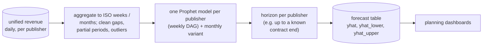

# Revenue forecasting per publisher

**Domain:** ad-network planning · **Stack:** Airflow, BigQuery, pandas, Prophet

## Problem

Sales, finance and account managers need to know what each publisher is likely to earn in the coming weeks and months:
for targets, cash-flow planning and spotting accounts that are trending down before they churn.

## Pipeline

- **Weekly and monthly runs.** A weekly DAG retrains on the latest complete week. A monthly v2 pipeline produces
  month-level forecasts for finance.
- **One model per publisher.** Publishers differ too much in seasonality and size for a pooled model. Prophet keeps
  per-publisher models cheap, and its uncertainty interval goes into the dashboards with the point forecast.
- **Clean inputs.** Partial current periods are dropped, missing days are filled before weekly aggregation, and
  forecast periods are labelled with ISO year and week, so they join cleanly with actuals.
- **Business-aware horizon.** The number of weeks forecast per publisher can stop at a known departure date instead
  of a fixed horizon.

**Results:** [TODO: accuracy, e.g. "MAPE ~X % on 4-week horizon"]
