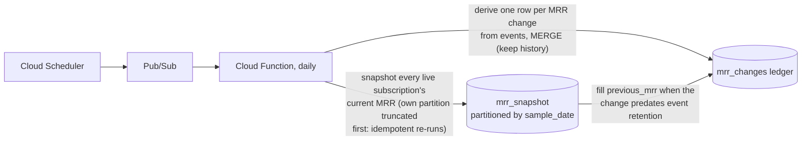
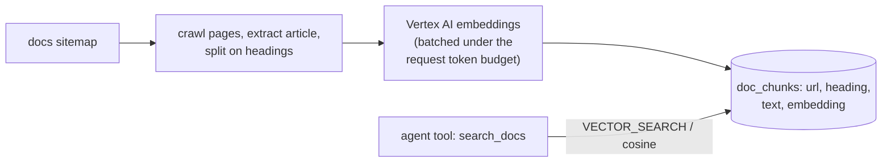

# SaaS revenue history and a RAG index for support, on BigQuery

**Domain:** B2B SaaS analytics and support tooling · **Stack:** Cloud Functions, Cloud Scheduler, Pub/Sub, BigQuery
(MERGE, partitioning, vector search), Vertex AI text embeddings, Terraform, billing/CRM REST APIs

## 1. Reconstructing MRR history from an API that forgets

**Problem.** Finance wanted MRR movements (new, expansion, contraction, churn) over time. The billing platform's
events API keeps only about 90 days of history, and its "current MRR" field is just that: current.

**Solution.** Two tables, combined:

- The **daily snapshot** is a durable baseline that outlives the API's retention window.
- The **change ledger** accumulates through `MERGE`, so rows that have aged out of the API are never lost.
- Where an event's previous value is no longer available, it is filled from the most recent earlier snapshot.
  Coverage grows automatically with every run.

Related replicas built on the same pattern: subscription ramps (scheduled future changes), entitlements and plan
features, and CRM deal line items, which back-fill deals that the vendor's connector missed.

## 2. RAG index of the product documentation

**Problem.** A support AI agent needed to answer from the official product docs and cite them, without a separate
vector database to run.

**Solution.** BigQuery is the vector store:

- Chunks follow the page's heading structure, so every hit maps to a section a human can open.
- Embedding calls are batched by count and by a character budget, staying under the model's per-request limit.
- The index refreshes on a schedule, and the agent's search tool returns the URL and heading of each passage for citations.

**Results:** [TODO: e.g. "MRR history now covers N months beyond the API window", "support agent answers grounded in N doc sections"]
