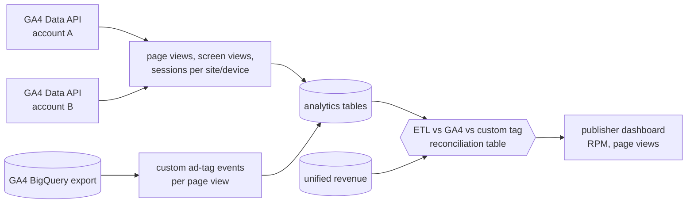

# Web analytics pipelines and revenue reconciliation

**Domain:** publisher analytics · **Stack:** GA4 Data API, GA4 BigQuery export, Airflow, BigQuery, Looker Studio

## Problem

Revenue per thousand page views (RPM) is the number publishers judge an ad network by. It divides **revenue** (from the
ad partners, see [multi-source revenue ETL](multi-source-revenue-etl.md)) by **traffic** (from Google Analytics 4,
across many publisher properties and more than one GA4 account). If either side is late, partial or defined
differently, RPM swings and people read it as a real business change.

## What the pipelines do

- Extracts GA4 metrics (page views, screen views, sessions) for every site in an inclusion sheet, across two GA4
  accounts, with traffic from excluded countries filtered out.
- Reads the network's own ad-tag events from the GA4 BigQuery export, so "monetisable" page views (pages where the ad
  tag actually loaded) can be compared with all page views.
- Builds a reconciliation table that puts ETL revenue, GA4 traffic and tag events side by side per site, day and
  device. The dashboard's RPM charts read from it.

## Problems I fixed

| Symptom | Root cause | Fix |
|---|---|---|
| RPM spikes and drops on the most recent days | The join ran before its inputs landed, because schedules were in a local time zone with DST shifts | Schedules moved to UTC and ordered after the extracts inside one DAG |
| Page views occasionally became 0 for a site | A partial re-run overwrote good rows with zeros | The load never overwrites existing page-view events with zeros |
| Device breakdown didn't match the dashboard | Device mapping was defined in three places | Unified the mapping across the scheduled queries, the view and the DAG |
| Whole runs failing on one site | A renamed header in the config sheet | Validation of the inclusion sheet and per-site error isolation |

## Takeaway

Most "data is wrong" reports weren't ETL bugs. They came from **freshness and definition** issues: late exports,
partial days, by-design zeros in dashboard formulas. I documented a first-response checklist (check day coverage,
export freshness and formula windows before touching the ETL), which cut time spent chasing false alarms.
